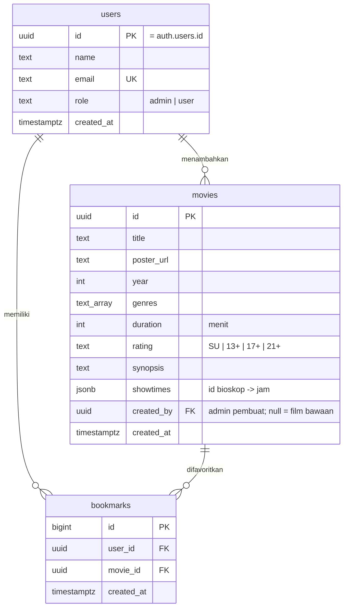

# Tayang

Aplikasi Flutter buat lihat film yang lagi tayang di bioskop **Jakarta & sekitarnya**, dengan database
online di [Supabase](https://supabase.com) (PostgreSQL).

- **Login & daftar akun**: email + password, dengan dua role:
  - **admin**: bisa tambah, edit, dan hapus film
  - **user**: cuma bisa lihat film dan nyimpen favorit
- **Cari judul film**
- **Filter lokasi**: pilih wilayah (Jaksel, Jakpus, Jakbar, Jakut, Jaktim, Bodetabek), terus kalau mau bisa pilih satu bioskop
- **Poster** di daftar film, plus header besar di halaman detail
- **Favorit**: tandai film pakai ikon penanda, terus lihat semua favoritmu di tab *Favorit*
- **Kelola film (admin)**: tambah dan edit judul, poster (dari galeri atau link gambar), genre, rating, sinopsis, dan jadwal per bioskop, plus hapus film. Perubahan langsung kelihatan sama semua pengguna
- **Peta ↗**: buka lokasi bioskop di Google Maps

Bisa jalan di **Android** (APK) dan di **browser** (Chrome).

> **Mau jalanin di laptop lain?** Ikutin [TUTORIAL.md](TUTORIAL.md). Isinya langkah demi langkah dari nol sampai app-nya jalan.

## Database

Tiga tabel di PostgreSQL (Supabase):



- **users** ↔ **movies**: satu admin bisa nambah banyak film (`movies.created_by`).
- **users** ↔ **bookmarks** ↔ **movies**: relasi *many-to-many*. Satu user bisa punya banyak film favorit,
  dan satu film bisa difavoritkan banyak user. Kombinasi `(user_id, movie_id)` dibuat unik biar nggak dobel.
- Password nggak disimpan di tabel `users`. Login ditangani **Supabase Auth**, dan baris `users` dibuat
  otomatis oleh trigger waktu ada akun baru.
- Hak akses tiap tabel dijaga **Row Level Security** di database, jadi bukan cuma disembunyiin di app:
  - cuma `role = 'admin'` yang bisa insert, update, atau delete di `movies`
  - user nggak bisa ngubah kolom `role`-nya sendiri
  - tiap user cuma bisa lihat favoritnya sendiri

Skema lengkapnya ada di [`supabase/schema.sql`](supabase/schema.sql), cara setup-nya di [`supabase/SETUP.md`](supabase/SETUP.md).

## Jalanin cepat

Kalau Flutter udah terpasang:

```bash
git clone https://github.com/AbdiJ09/tayang.git
cd tayang
flutter pub get
flutter run -d chrome
```

Perintah di atas nyambung ke database bawaan repo. Mau pakai **project Supabase sendiri**? Jalanin
`supabase/schema.sql` di project-mu, copy `supabase.example.json` jadi `supabase.json`, isi URL dan publishable
key-nya, terus jalanin pakai `flutter run -d chrome --dart-define-from-file=supabase.json`. Langkah lengkapnya
ada di [TUTORIAL.md](TUTORIAL.md).

## Struktur

```
assets/data/tayang.json   data wilayah & bioskop
supabase/schema.sql       tabel, relasi, role, RLS, storage, data awal
supabase/upgrade_roles.sql  upgrade project lama → role admin/user
supabase.example.json     contoh config Supabase pribadi (copy → supabase.json)
lib/config.dart           URL & publishable key Supabase bawaan
lib/main.dart             entry point + cek login (AuthGate)
lib/auth_page.dart        halaman masuk / daftar
lib/data.dart             model (AppUser, Movie) + query Supabase
lib/home.dart             halaman utama: search, filter wilayah/bioskop, daftar film
lib/detail.dart           halaman detail: poster, sinopsis, jadwal per wilayah
lib/add_movie.dart        form tambah film
lib/poster.dart           widget poster (URL / galeri / poster teks pengganti)
lib/theme.dart            warna & tipografi
```

## Data

- **Film & jadwal** ada di tabel `movies`. Bisa diubah lewat app (admin: **+ Tambah**, **Edit film**) atau langsung di
  Supabase **Table Editor**. Kolom `showtimes` formatnya `{ "<id bioskop>": ["13:00", "15:30"] }`.
- **Wilayah & bioskop** ada di [`assets/data/tayang.json`](assets/data/tayang.json), karena jarang berubah.
  Id bioskop di sini yang dipakai sebagai kunci di `showtimes`.

7 film bawaan cuma **contoh**. Cek ulang judul dan jam tayangnya sebelum dipakai beneran.
Poster diambil dari [TMDB](https://www.themoviedb.org/).

## Build APK

```bash
flutter build apk --release
```

Hasilnya ada di `build/app/outputs/flutter-apk/app-release.apk`.
